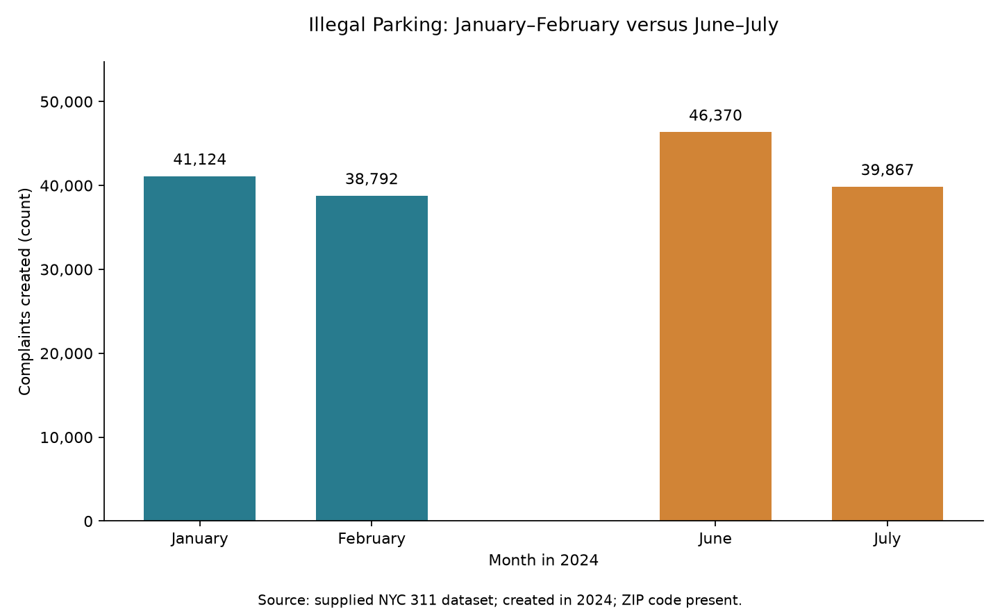

# Complaint type analysis

## Method
We interpreted “overall most abundant” as the highest total complaint count across the full filtered 2024 dataset. We ran `borough_complaints.py` from Jupyter, then added each type's counts across boroughs. We selected complaints by creation date, including both range endpoints, and retained unclosed complaints. Only records with a ZIP code were included.

## Findings
**Illegal Parking** was the most common complaint type, with **505,546** reports out of **3,423,953** eligible complaints (14.8%).

- January: 41,124 complaints
- February: 38,792 complaints
- June: 46,370 complaints
- July: 39,867 complaints

January–February had **79,916** reports; June–July had **86,237**. The change from the first period to the second was **+6,321 reports (+7.9%)**.

The periods contain 60 and 61 days respectively. Their daily averages were **1,331.9** and **1,413.7** reports, a **+6.1%** change. This accounts for the unequal number of days.

## Interpretation and limitations
The chart describes the difference in reported complaint volume between these periods. It does not establish its cause or demonstrate a recurring seasonal pattern from one year alone. Counts may reflect reporting behavior as well as actual problems, and multiple reports can concern the same problem. Missing-ZIP complaints were excluded. These are complaint counts, not measurements of service quality or closure speed.

## Reproduce
Run `complaint_analysis.ipynb` from top to bottom with the filtered dataset in `data/311_2024.csv`. The notebook regenerates this report and the chart.
